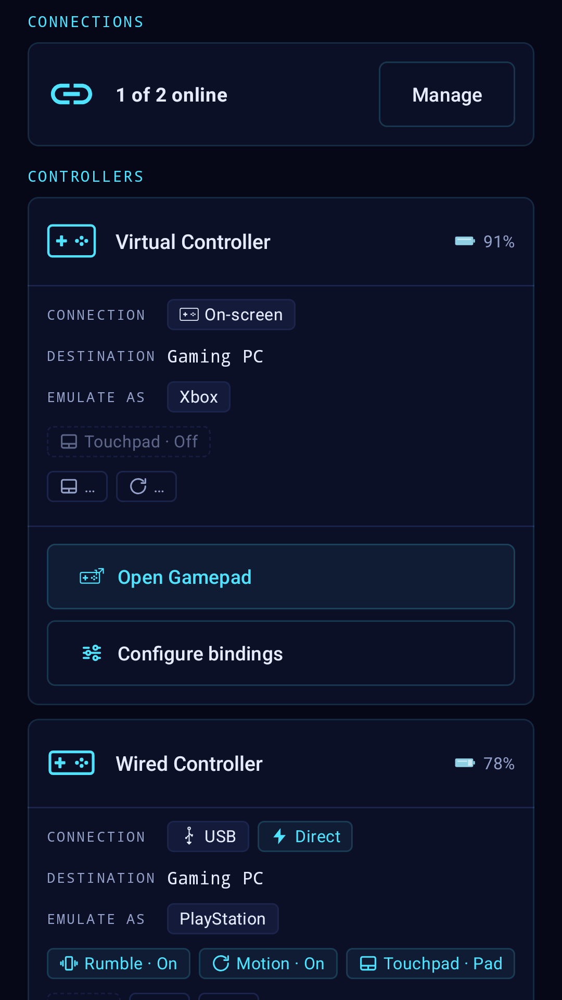
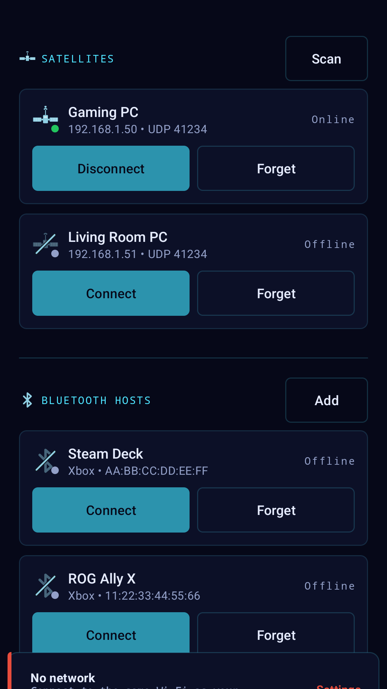

# Dish for Android

Dish for Android turns your Android phone, tablet or handheld, and any controller you connect to it, into a wireless controller for your PC.

Dish is made of two parts. The Dish apps run on the device that holds your controller, or that is the controller: Dish for Android, Dish for iOS, Dish for macOS, Dish for Windows and Dish for Linux. Satellite is the small server on the PC you play on, and it makes each Dish controller look to your games like a controller plugged into that PC. You need one of each. Everything is free and open source, the website is [dish.tinkernorth.com](https://dish.tinkernorth.com), and I maintain all of it on my own.

Dish for Android can also be the controller for a PC that streams with Sunshine, Apollo or Wolf, without Satellite, and it can pair with a PC as an ordinary Bluetooth controller.

<p>
  
  
</p>

These are the store screenshots, taken from the app with made-up PCs and controllers.

## Download

Dish for Android 2.8.0 is the current release. Every link below always points at the newest one.

Most phones, tablets and handhelds: install [Dish from Google Play](https://play.google.com/store/apps/details?id=com.tinkernorth.dish). Google Play keeps it up to date. A new version can reach Google Play a little after GitHub, while Google reviews it.

Without Google Play, or to have a release the day it ships: download **[dish.apk](https://github.com/TinkerNorth/dish-android/releases/latest/download/dish.apk)** on the device and open it. The first time, Android asks you to allow installs from your browser or file manager. This build checks GitHub for a newer release and tells you when there is one, but it never downloads or installs anything itself; you get the next APK the same way.

All files and older versions are on the [releases page](https://github.com/TinkerNorth/dish-android/releases).

### Satellite and the Dish apps

| App | Where to get it |
|---|---|
| Satellite (Windows, Linux) | [GitHub releases](https://github.com/TinkerNorth/satellite/releases/latest) |
| Dish for Android | [Google Play](https://play.google.com/store/apps/details?id=com.tinkernorth.dish), or the APK from [GitHub releases](https://github.com/TinkerNorth/dish-android/releases/latest) |
| Dish for iOS | Not yet released |
| Dish for macOS | [GitHub releases](https://github.com/TinkerNorth/dish-mac/releases/latest) |
| Dish for Windows | [GitHub releases](https://github.com/TinkerNorth/dish-windows/releases/latest) |
| Dish for Linux | [GitHub releases](https://github.com/TinkerNorth/dish-linux/releases/latest) |

## Getting started

1. Install Satellite on the PC you play on and start it. Its dashboard shows a 4-digit PIN under Device Pairing, with a new one every five minutes. If you stream with Moonlight from Sunshine, Apollo or Wolf instead, that host is all the PC needs.
2. Install Dish on your device. It has to be on the same local network as the PC. The first time it opens, Set up Dish asks how you want to play (Wired controller, Bluetooth controller or On-screen gamepad) and how input reaches your PC (Satellite over Wi-Fi, Moonlight hosts or Bluetooth host), and walks you through the rest.
3. Pair them. On the main screen, tap Manage beside Connections, then Scan; one scan finds Satellites and Moonlight hosts. Tap your PC and type the PIN Satellite shows. If you'd rather, Dish can show its own PIN instead (Accept on satellite), and you accept the request on the dashboard only if the two PINs match. A Moonlight host works the other way round: Dish shows a PIN and you type it into the host's Moonlight or Sunshine page. Either way you only pair once.
4. Play. Each controller has a card on the main screen. Its Destination is the PC it goes to, and Emulate as is the controller your games see: Xbox, PlayStation, DualSense, Switch Pro or DualSense Edge, whichever that PC offers. For the on-screen controller, tap Open Gamepad.

## What it does

A controller reaches Dish in one of four ways: plugged into the device's USB port, paired with the device over Bluetooth, the built-in controls of a handheld that Android sees as a gamepad, or the on-screen gamepad and touchpad. A USB controller can be read two ways. USB Standard goes through Android's own gamepad support and works with anything. USB Direct reads the controller hardware itself, after a one-time permission from Android, for the lowest latency. Dish never picks Direct on its own for a controller whose layout hasn't been confirmed, but you can still choose it.

From the device, input goes one of three ways. To Satellite over Wi-Fi, encrypted, with the lowest latency and every feature. To a Sunshine, Apollo or Wolf host, where Dish plugs a controller into a Moonlight session; it only carries the controller and never shows the stream. Or straight to a PC, console or set-top box as a standard Bluetooth controller, with nothing to install there (this needs Android 9 or newer). Each controller has its own card and destination, so several controllers can play on different PCs at once.

Motion and the touchpad reach the game on the controller types that have them, and rumble comes back to the controller, or to the device's own vibration motor for the on-screen controller. A Satellite or Moonlight host is told the lower of the controller's battery and the device's, so its low-battery warning is about whichever runs out first.

With Satellite and an emulated DualSense or DualShock 4, the controller can have its own microphone and speaker. Switch Microphone on for a controller and the device's microphone becomes the pad's, so voice chat on the PC hears you through it; it is off until you turn it on, and muting stops the capture instead of sending silence. With Controller sound on, the pad's audio comes back to the controller. A DualSense on a USB cable whose sound output the device can open with all four channels also gets the HD haptics games send as audio; for any other controller Satellite turns them into rumble. The light bar, player lights and adaptive triggers a game sets through Satellite reach the controllers that have them. From 2.4.0 until 2.7.0 the released builds left out part of the code these need, so if you tried them on an older version and nothing happened, update and try again. Bluetooth and Moonlight hosts carry no controller audio.

Steam Controllers, the 2015 model and the 2026 one, work on a cable, through their wireless adapters, and paired with the device over Bluetooth. Each one has a Trackpads setting: Right stick, Touchpad, Mouse or Off. Their back buttons, and a DualSense Edge's, reach a Satellite that speaks protocol 4, and Emulate as DualSense Edge gives the game somewhere to put them. I haven't had a real Steam Controller or DualSense Edge to test with, and no one has tried them with Dish yet, so this follows SDL and the Linux driver rather than hardware.

The controllers Dish recognises come from one controller database that every Dish app shares, published at dish.tinkernorth.com. Dish ships with a copy and checks for a newer one about ten seconds after it starts and every six hours while it runs, so a newly added controller works without an app update. The database is data, never code, and Dish uses a download only when every file matches the checksums the website published.

When something doesn't work, Settings has Diagnostics. Each controller's card there says which record in the database it matched, whether that record was confirmed on hardware (one that wasn't says "Layout guessed"), and any known issue for that controller on your device. The controller inspector tests rumble, the light bar, player lights, adaptive triggers, the speaker, haptics, the microphone and stick drift, and asks after each test whether it worked. The on-screen gamepad and touchpad show how many touch and motion readings per second they send.

## Requirements

Android 7.0 or newer, on 64-bit or 32-bit ARM or on x86_64, which includes the 32-bit Amazon Fire tablets. Pairing with a PC as a Bluetooth controller needs Android 9 or newer. A USB controller needs a device that can act as a USB host (USB OTG).

Network access comes with the install, and on Android 17 and newer Android also asks you the first time Dish reaches a host on your local network. It asks for Bluetooth when you add a Bluetooth controller or host, for notifications on Android 13 and newer so it can show the notification while a controller streams, and for the microphone only when you switch a controller's Microphone on or start the inspector's microphone test. It does not ask for location, contacts, the camera or your files.

Network: the device and the PC on the same local network. Satellite takes input on UDP 9876 and pairs on TCP 9443, and Dish finds it over mDNS. A Moonlight host pairs on port 47989 and then uses port 47984.

Android 6 and older are not supported.

## Trust and privacy

Every release has a `SHA256SUMS` file signed with cosign by the release workflow. To check a download on Linux, put `SHA256SUMS` beside it and run:

```bash
sha256sum --ignore-missing -c SHA256SUMS
```

On a Mac, `shasum -a 256 --ignore-missing -c SHA256SUMS` does the same; `dish.apk` and the versioned APK on the release page are the same file under two names. [SECURITY.md](SECURITY.md) has the signature and build provenance checks, and how to report a vulnerability.

The APK on GitHub is signed with my own release key. To check it, run `apksigner verify --print-certs dish.apk` from the Android SDK's build tools: the certificate's SHA-256 digest is `20348e63be387f3ab1ba280b2031b08c4558f5c421c87dbae9cceb36577585d1`. Android also refuses to update an installed APK with one signed by a different key. Google Play installs and updates the Play build itself. I upload the bundle to Google Play signed with this same key (its certificate has the same digest), but Google Play signs the APK it delivers to your device with its own app-signing key, and I haven't confirmed that key is the one above. So don't count on installing the GitHub APK over the Play build, or the other way round: uninstall first when you switch.

The release workflow also builds an Amazon Appstore APK for Fire tablets, but it doesn't upload it (the Amazon credentials aren't set up), so nothing in this repository publishes to the Amazon Appstore. On a Fire tablet, install the GitHub APK; it carries the 32-bit library those tablets need.

Dish for Android works on your own network and has no account, no analytics and no ads. Three things can leave your device, and each has a switch in Settings: a crash report to Google's Firebase Crashlytics if Dish crashes (Share crash reports, on by default), a check for a newer controller database at dish.tinkernorth.com, and, in the GitHub build only, a check for a new version against GitHub. Controller input and microphone audio go only to the PC you paired with. A support report is something you send yourself, from your own mail app; Dish never sends it. In the Google Play build you can leave a tip through Google Play, and Google, not Dish, handles the payment; the GitHub build links to donation pages instead. [PRIVACY.md](PRIVACY.md) says exactly what is stored and sent.

Dish for Android is licensed under the GNU Lesser General Public License v3.0 or later ([LICENSE](LICENSE), with [COPYING.GPL3](COPYING.GPL3)). The third-party components and their licences are in [THIRD_PARTY.md](THIRD_PARTY.md).

## For developers

Dish for Android is Kotlin, with the input path in C++ through the NDK, built with Gradle. You need an Android Studio that supports the pinned Android Gradle Plugin, the NDK and CMake versions the build names, and a JDK 17 or newer to start Gradle; [CONTRIBUTING.md](CONTRIBUTING.md) has the details.

```bash
scripts/setup-hooks.sh                                                  # once: the pre-commit hook
./gradlew --no-daemon assembleGithubDebug testGithubDebugUnitTest       # build, then the unit tests
scripts/ci-local.sh                                                     # what the main CI job runs, in its order
```

The app comes in three flavors: `github` (the APK on GitHub), `play` (Google Play, with tips through Play Billing) and `amazon` (no tips, updated by its store). `scripts/ci-local.sh --quick` runs the fast gates. The C++ host tests build only on Linux, so on another OS `scripts/ci-local.sh` runs them in a Docker container.

Where things are written down:

- [docs/ARCHITECTURE.md](docs/ARCHITECTURE.md): the packages, the hot path, the controller database and diagnostics, Bluetooth and rumble.
- [docs/contract.md](docs/contract.md): how this client maps the protocol in Satellite's contract, which is the single source of truth.
- [docs/rumble.md](docs/rumble.md): how rumble reaches the right motor, and what Android can and cannot drive.
- [docs/usb-direct-mode-followups.md](docs/usb-direct-mode-followups.md): what is still owed on the USB Direct path.
- [DESIGN.md](DESIGN.md): the design tokens, components, navigation and the distribution flavors.
- [play/README.md](play/README.md): the Google Play listing, its release notes, tracks and screenshots; [play/BILLING.md](play/BILLING.md) has the tips.
- [CHANGELOG.md](CHANGELOG.md): what changed in each release.

[CONTRIBUTING.md](CONTRIBUTING.md) covers getting set up, where code goes, the UI and translations, the style, the tests, what CI runs, how a release is cut, and the hot path and wire protocol rules. Please read it before opening a pull request.

## Getting help

If something doesn't work, open an issue at [github.com/TinkerNorth/dish-android/issues](https://github.com/TinkerNorth/dish-android/issues/new/choose). The most useful thing you can attach is the diagnostics file: in Dish, open Settings, then Diagnostics, and tap Report a problem. Say what happened, pick the controller, and tap Continue in mail app; Preview file shows you the file first. The file leaves out pairing keys, PINs, addresses and device names; read it before you attach it, it's plain JSON. Continue in mail app starts a mail to support@tinkernorth.com with the file attached, so if you'd rather write to me than open an issue, send that mail; nothing leaves your device until you press Send.

Please also say which Dish for Android version you run and how you installed it, your device and Android version, which Satellite or Moonlight host and version you use, and which controller. If the problem is in Satellite rather than here, its own repository is the better place. For a security problem, don't open a public issue; [SECURITY.md](SECURITY.md) says how to report it privately.
